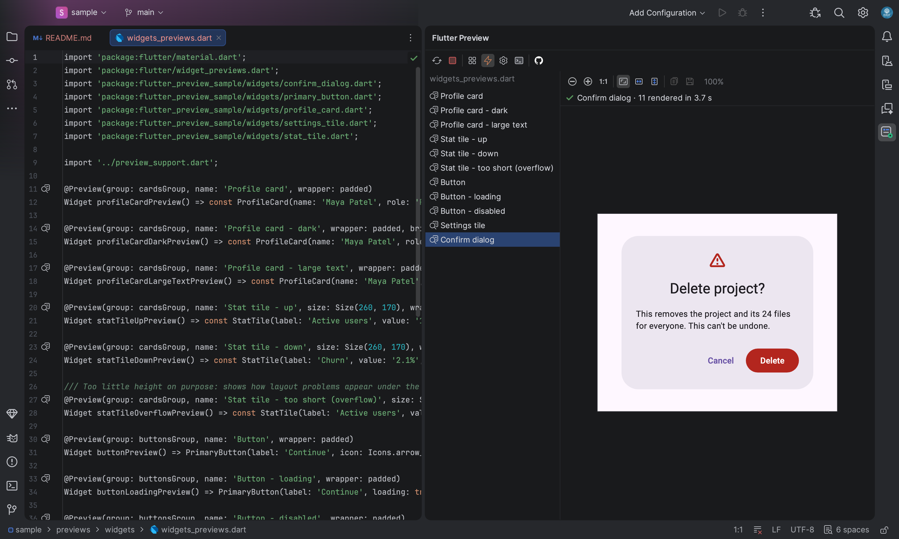
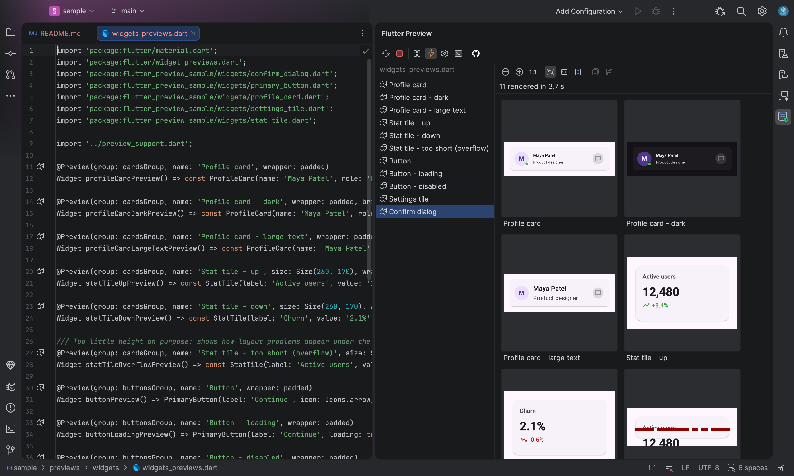
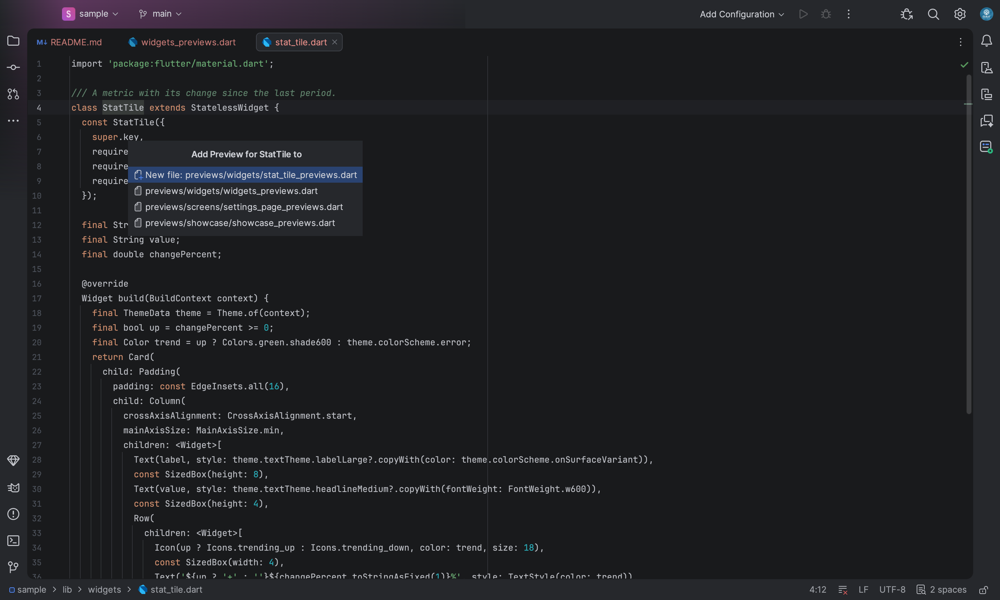

# Flutter Preview

An Android Studio plugin that renders Flutter `@Preview` widgets right in the IDE. It runs **headlessly with
`flutter test`**, so it needs no browser, no emulator and no running app.

Open a Dart file with `@Preview` annotations. The **Flutter Preview** tool window lists the previews, renders all
of them in one run, and re-renders them when you save.



| Grid view | Generate Flutter Preview… |
|---|---|
|  |  |

Want to try it first? The [`sample/`](sample) folder is a small Flutter package with ready-made previews.

## Why

Flutter's own widget previewer runs your previews as a Flutter **web** app in Chrome or an embedded Chromium. That
breaks for many real-world widgets, which use `dart:io`, native plugins or platform-specific code, and it's heavy to
run inside the IDE.

This plugin renders with the same engine your widget tests use. It generates a test that pumps each preview and
writes a PNG with `RenderRepaintBoundary.toImage`, using real fonts (Roboto, Material Icons and your app's
fonts), real assets, and your theme or wrapper.

## Features

* **Whole-file rendering.** All previews of a file render in a single `flutter test` run, typically 3–5 s for a
  file of widget previews. Selecting a preview afterwards is instant. The renders of the last few files stay cached.
* **Render on save.** Saving any Dart file of the package re-renders in the background, while the previous images
  stay visible. If the code doesn't compile mid-edit, the last good previews stay up with a red status, and the
  compiler output is one click away.
* **Single view with zoom:** zoom in and out, 100 %, Fit All, Fit Width and Fit Height. ⌘/Ctrl + mouse wheel also
  zooms. The zoom setting is kept across re-renders.
* **Grid view:** thumbnails of every preview in the file. Zoom changes the thumbnail size.
* **Copy Image / Save Image As…:** export the 2x PNG for MRs, tickets or docs.
* **Editor integration** (needs the Dart plugin):
  * a gutter icon on every `@Preview`, which opens that preview,
  * the caret follows: moving into a preview function selects it,
  * **Alt+Enter → "Create @Preview for this widget"** generates a preview function with placeholder arguments.
  * **Right-click → "Generate Flutter Preview…"** on a widget class, or on a usage such as `StatusTile(`, adds a
    preview to the package's `previews/` folder: a new file that mirrors the widget's location
    (`lib/widgets/status/status_tile.dart` → `previews/status/status_tile_previews.dart`), or an existing preview file
    of your choice. It adds only the imports that are missing, and reuses the target file's `group:` and `wrapper:`.
* **Problems, not crashes.** Overflow and layout errors are listed under the image. Repeating animations such as
  spinners are noted, not treated as errors.
* **Native calls are stubbed.** Platform channel calls that nothing answers get an empty success reply, so widgets
  that use plugins such as `wakelock_plus` still render.

## Requirements

| | |
|---|---|
| IDE | Android Studio 2026.2 (build 262) or newer |
| Flutter | A Flutter SDK with `flutter_test`, found through the package's `.dart_tool/package_config.json`, `FLUTTER_ROOT`, or `PATH` |
| Optional | The **Dart** plugin, for gutter icons, caret sync and the "Create @Preview" intention. The tool window works without it. |

The package must have run `flutter pub get` (`.dart_tool/package_config.json` must exist).

## Install

The plugin isn't on the JetBrains Marketplace yet. Build it from source:

```sh
git clone https://github.com/Jemshi101/FlutterPreview.git
cd FlutterPreview
./gradlew buildPlugin
```

Then in Android Studio go to **Settings → Plugins → ⚙ → Install Plugin from Disk…**, pick
`build/distributions/FlutterPreview-<version>.zip`, and restart.
Open the plugin from **View → Tool Windows → Flutter Preview**. To try it without your own project, open the
[`sample/`](sample) folder after running `flutter pub get` in it.

`gradle.properties` points `androidStudioPath` at `/Applications/Android Studio.app`; change it if your Android
Studio is installed somewhere else.

## Writing previews

Use Flutter's standard annotation from `package:flutter/widget_previews.dart`, on a top-level function, a static
method or a constructor that takes no required arguments:

```dart
import 'package:flutter/material.dart';
import 'package:flutter/widget_previews.dart';

Widget darkCard(Widget child) => Material(color: Colors.black, child: child);

@Preview(name: 'Status tile', size: Size(360, 120), wrapper: darkCard)
Widget statusTilePreview() => const StatusTile(label: 'Online');

class StatusTile extends StatelessWidget {
  const StatusTile({super.key, required this.label});
  final String label;

  @Preview(name: 'Status tile - long label', brightness: Brightness.dark, textScaleFactor: 1.5)
  static Widget longLabel() => const StatusTile(label: 'A very long status label that wraps');

  @override
  Widget build(BuildContext context) => ListTile(title: Text(label));
}
```

| `@Preview` argument | Effect |
|---|---|
| `name`, `group` | Title in the list (the group is shown in the tooltip) |
| `size` | Fixed logical size: any `Size` expression, e.g. `Size(390, 844)` or a constant like `kPhoneSize`. Use `double.infinity` for a dimension that shouldn't be fixed. Without it, the preview is 400 wide and as tall as its content (up to 800). |
| `wrapper` | A `Widget Function(Widget)` that wraps the preview (theme, padding, providers…) |
| `brightness` | A `Brightness` expression for the `MaterialApp` theme |
| `textScaleFactor` | Text scaling (any `double` expression) |

Argument values are evaluated in Dart exactly as written, so constants and getters work, as long as they are public: the renderer is a separate library and can't see `_private` names (such previews are flagged in the list).

Previews can live anywhere in the package, such as `lib/` or a top-level `previews/` folder, as long as the file is
inside the package that contains `pubspec.yaml`.

### Setup hook

Each package gets a plugin-only setup file, **`.flutter_preview/setup.dart`**:

```dart
Future<void> flutterPreviewSetup() async {
  // Initialise singletons your widgets read at startup: localization, service locators, mock channels…
}
```

* The first render in a package creates it from a commented template, adds `/.flutter_preview/` to the package's
  `.gitignore` (creating the file if needed), and shows a notification with an **Open** link.
* It's local to each developer and only used by the plugin. It isn't part of your app or your tests, so test mock
  helpers stay where they belong.
* Open it any time with **Edit Preview Setup** (⚙) in the tool window toolbar.
* The plugin calls it once before rendering, with real async I/O, so it can load files or assets.
* If you delete the `.gitignore` entry on purpose, it isn't added back.

### Native plugins and platform channels

There is no Android or iOS side under `flutter test`. Any platform channel call that nothing answers gets an empty
success reply. The status line notes the plugins that were stubbed, for example
`native calls stubbed: wakelock_plus_platform_interface`. `void` calls just do nothing. Calls that need a real value
get `null`. To return something specific, register a mock in `.flutter_preview/setup.dart`. Mocks take precedence over the stub:

```dart
import 'package:flutter/services.dart';
import 'package:flutter_test/flutter_test.dart';

Future<void> flutterPreviewSetup() async {
  TestDefaultBinaryMessengerBinding.instance.defaultBinaryMessenger.setMockMethodCallHandler(
    const MethodChannel('my_app/settings'),
    (MethodCall call) async => call.method == 'getUnits' ? 'metric' : null,
  );
}
```

## How it works

```
Dart file ──► PreviewParser ──► HarnessGenerator ──► .dart_tool/flutter_preview/preview_test.dart
 (@Preview)    text scan,        one testWidgets            │
               no PSI needed     per preview                ▼
                                                     flutter test --no-pub
                                                            │  per preview: load fonts → pump
                                                            │  wrapper(preview()) → precache images
                                                            │  → settle → toImage → p<N>.png + .json
                                                            ▼
Tool window ◄── per-file cache ◄── PreviewRenderer (PNG, problems, notes, log)
```

* **`PreviewParser`** finds `@Preview(...)` annotations in the source text, ignoring comments and strings. It
  works out how to call each one, for example `MyWidget.preview()`, and records its arguments and source range.
* **`HarnessGenerator`** writes a test file that imports the previewed library and all of that library's imports, so
  `wrapper:` and the preview expressions resolve exactly as they do in your file. Its own imports are prefixed,
  so they never clash with yours.
* **`PreviewRenderer`** runs `flutter test` and collects one PNG and one JSON file of problems and notes per preview.
* The `core` package uses no IntelliJ APIs. The `ui` package holds the tool window, and the `dart` package holds
  the optional Dart-plugin features.

### Generated previews

Both generators fill required constructor arguments with placeholders: `'Label'` for a `String`, `() {}` for
callbacks, `const Placeholder()` for a `Widget`, `16.0` for size-like `double`s, `const []` for lists. A type they
can't guess becomes `throw UnimplementedError('TODO: name (Type)')`, which renders as an error until you replace
it. They choose the unnamed constructor, then the public named one with the fewest required arguments. A preview in
a separate file can't use private classes or private constructors, and "Generate Flutter Preview…" says so instead
of writing code that won't compile.

## Project layout

```
src/main/kotlin/in/bleuphoenix/flutterpreview/
├─ core/   PreviewParser, DartText, HarnessGenerator, PreviewRenderer, PreviewStubGenerator, PreviewFileGenerator,
│          PreviewSetup, FlutterProject (pub root, SDK lookup)
├─ ui/     tool window: FlutterPreviewPanel, PreviewImageComponent (zoom), PreviewGridPanel, PreviewImages (copy/save)
├─ dart/   PreviewLineMarkerProvider (gutter), CreatePreviewIntention, GeneratePreviewAction (context menu),
│          loaded only with the Dart plugin
└─ dev/    ScreenshotRunner: produces the screenshots in docs/images (inert unless enabled, see below)
src/main/resources/
├─ META-INF/plugin.xml, flutterpreview-dart.xml, pluginIcon.svg
└─ templates/preview_harness.dart, preview_setup.dart
docs/       Marketplace description and images
sample/     a Flutter package with previews, used for the screenshots and for trying the plugin
CHANGELOG.md   also becomes the plugin's change notes at build time
PLAN.md        design notes and the decision to render headlessly instead of in a browser
```

## Development

```sh
./gradlew buildPlugin        # build/distributions/FlutterPreview-<version>.zip
./gradlew runIde             # sandbox Android Studio with the plugin loaded
./gradlew test               # unit tests: parser, preview generator
```

Integration tests render real previews. Point them at a Flutter package that has `@Preview`s:

```sh
FP_IT_PROJECT=/path/to/flutter/package ./gradlew test --rerun
```

* `RenderIntegrationTest` renders every preview in the package; the PNGs go to `build/preview-renders/`.
* `StubIntegrationTest` generates a preview with "Create @Preview" for each widget file it checks and renders it;
  the PNGs go to `build/stub-renders/`.
* `GenerateFileIntegrationTest` uses "Generate Flutter Preview…" to write new preview files, and to append to a copy
  of an existing one, then renders them. Its temporary `previews/**/zz_fp_check_*.dart` files are always deleted;
  the PNGs go to `build/generated-renders/`.

### Screenshots

`docs/images/screenshot-*.png` are captured by the plugin itself in a sandbox IDE with the sample project open. It
paints the IDE window to PNGs, so it needs no screen-recording permission:

```sh
(cd sample && flutter pub get)
./gradlew runIdeForScreenshots -PlocalIdePluginsDir="$HOME/Library/Application Support/Google/AndroidStudio2026.2/plugins"
cp build/screenshots/screenshot-*.png docs/images/
```

`localIdePluginsDir` points at an IDE install that has the Dart plugin, which Android Studio doesn't bundle. The
`render-*.png` images are the sample's `previews/showcase` previews, rendered by the plugin
(`FP_IT_PROJECT=$PWD/sample ./gradlew test --rerun`, then copy them from `build/preview-renders/`).

The build compiles against the local Android Studio install with a Java 25 toolchain (Android Studio's own JBR,
configured in `gradle.properties`), Kotlin 2.4 and IntelliJ Platform Gradle Plugin 2.x.

## Troubleshooting

| Symptom | What to do |
|---|---|
| "Flutter SDK not found" | Run `flutter pub get` in the package, or set `FLUTTER_ROOT`. |
| Red status "Last render failed" | The code didn't compile when it was saved. Open the log (console button) for the compiler error; the next good save fixes it. |
| Labels show raw keys, or singletons throw | Initialise them in `.flutter_preview/setup.dart` (**Edit Preview Setup**). |
| A widget needs a value from a platform channel | Mock that channel in `.flutter_preview/setup.dart`. |
| Text renders as black boxes | A font family isn't declared in `pubspec.yaml`, so only Roboto and the fonts in the FontManifest are loaded. |
| Nothing happens on save | Check that **Render on Save** (⚡) is on, or press **Render** (↻). |

## Limitations

* Each render is a fresh `flutter test` run: about 3–5 s per file of widget previews, and more for full-page previews
  that pull in a large part of the app. This is deliberate: nothing stays running between renders, so the ~1 GB the
  Dart compiler and the test engine use is released as soon as a render finishes.
* Previews are images: you can't tap or scroll them.
* Subclasses of `Preview` (MultiPreview) and `Preview` arguments other than those listed above aren't supported
  yet.

## Roadmap

* A variant matrix: light and dark, text scales, device sizes, RTL and locales side by side
* Click on the image to jump to the widget's source
* A visual diff against a pinned baseline

## License

Flutter Preview is free software, licensed under the [GNU General Public License v3](LICENSE) with additional terms
under section 7 (see [NOTICE](NOTICE)):

* **Attribution:** copies and modified versions, including forks, must keep the notice
  "Based on Flutter Preview by Jemsheer K D" with a link to this repository, in the NOTICE file, in their README, and
  in the plugin description when distributed as a plugin.
* Modified versions must be marked as modified, and may not use the name "Flutter Preview" or its icon as their own.

Copyright (C) 2026 Jemsheer K D.

Flutter Preview is an independent project. It is not affiliated with or endorsed by Google or the Flutter team.
Flutter and the related logo are trademarks of Google LLC.
